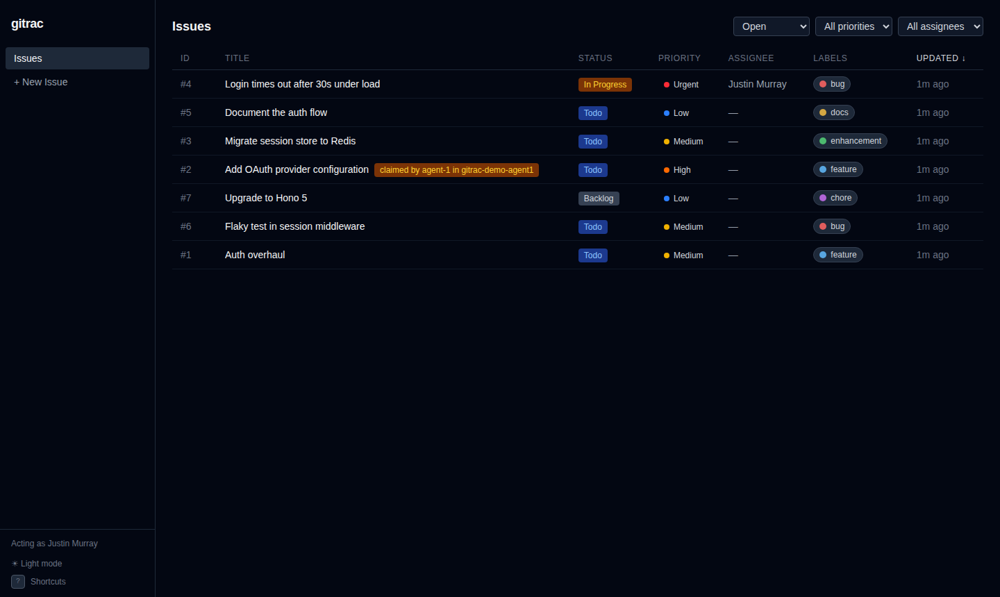
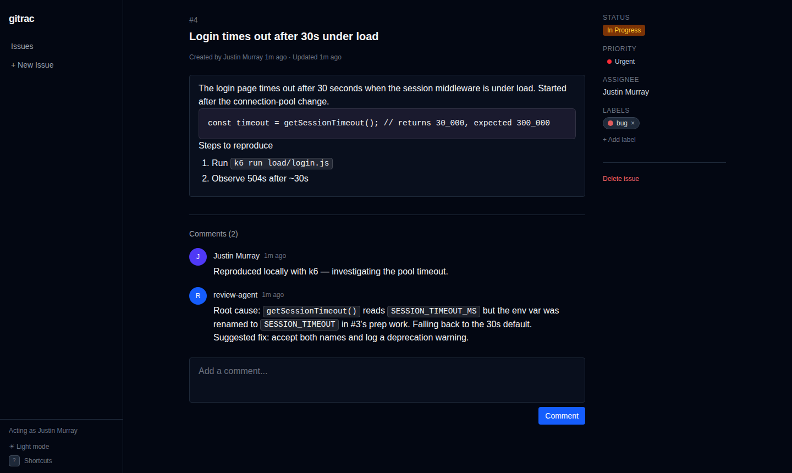

# gitrac

**Issue tracking that lives in your git repo.** Issues are plain markdown files with YAML frontmatter, committed right next to your code. gitrac manages them through a CLI that both humans and coding agents can drive, plus a local web UI in the style of Linear.



- **Close an issue in the same commit that fixes it.** The issue is part of the change, not a separate system.
- **Offline, local, yours.** No server, no account, no SaaS. History, blame, branches and review are just git.
- **Built for agents.** JSON output, distinct exit codes, exclusive claims that work across git worktrees, dependency-aware `ready` / `next --claim`, and a skill file that teaches agents the workflow.

---

## Contents

- [Why gitrac?](#why-gitrac)
- [Installation](#installation)
- [Quick start](#quick-start)
- [How it works](#how-it-works)
- [The web UI](#the-web-ui)
- [CLI reference](#cli-reference)
- [Orchestrating coding agents](#orchestrating-coding-agents)
- [Configuration](#configuration)
- [Development](#development)
- [License](#license)

---

## Why gitrac?

Hosted issue trackers sit *next to* your code: separate permissions, separate history, separate search, and a web of links that rots over time. That's especially awkward when the "developer" is a coding agent. The agent needs credentials for yet another API. Its work and the issue it's working on get updated separately, and two agents can easily pick up the same task.

gitrac puts the tracker inside the repository:

| | Hosted tracker | gitrac |
|---|---|---|
| Where issues live | A remote database | `.issues/*.md` in your repo |
| Linking fix ↔ issue | "Fixes #123" convention | The same commit modifies both |
| Works offline / on a branch | No | Yes. Issues branch and merge with the code |
| Review | Separate UI | Issue changes show up in the PR diff |
| Agent access | API tokens, rate limits, SDKs | `gitrac ... -o json`, or just read the files |
| Coordinating parallel agents | Ad hoc | Exclusive claims, visible across worktrees |

The format is deliberately boring. Any tool (or person, or LLM) that can read markdown can read your backlog, even without gitrac installed.

---

## Installation

gitrac ships as a **single self-contained binary** for Linux (x64, arm64) and macOS (Apple Silicon). The web UI is embedded, and there's no runtime to install.

### Quick install (recommended)

```bash
curl -fsSL https://get.gitrac.dev | bash
```

The script:
- downloads the latest release binary to `~/.local/bin/gitrac`;
- offers to add that directory to your `PATH`;
- checks that the binary runs.

Re-run it at any time to update. Options (environment variables, e.g. `curl -fsSL https://get.gitrac.dev | GITRAC_VERSION=0.2.0 bash`):

| Variable | Effect |
|---|---|
| `GITRAC_VERSION` | Install a specific version instead of the latest |
| `GITRAC_INSTALL_DIR` | Install somewhere other than `~/.local/bin` |
| `GITRAC_NONINTERACTIVE=1` | Never prompt (CI, Dockerfiles). Prints PATH instructions instead of editing your shell rc |

The script is [`install.sh`](install.sh) in this repo. Read it first if you like.

### npm

```bash
npm install -g @gitrac/cli
```

This installs a small Node wrapper plus the prebuilt binary for your platform. It doesn't add a Bun or Node runtime dependency to gitrac itself. It also works with `pnpm add -g`, `bun add -g`, and one-off runs via `npx @gitrac/cli ls`.

### Manual download

Grab `gitrac-<os>-<arch>` (`linux-x64`, `linux-arm64`, `darwin-arm64`) from [GitHub Releases](https://github.com/murrayju/gitrac/releases):

```bash
curl -fsSL -o ~/.local/bin/gitrac \
  https://github.com/murrayju/gitrac/releases/latest/download/gitrac-linux-x64
chmod +x ~/.local/bin/gitrac
```

On macOS, if you downloaded the binary with a browser, clear the quarantine flag once: `xattr -d com.apple.quarantine ~/.local/bin/gitrac`.

### From source

No global tooling is required. The repo's `./bun` script downloads a pinned version of [Bun](https://bun.sh) on first use.

```bash
git clone https://github.com/murrayju/gitrac.git
cd gitrac
./bun install
./bun run scripts/build.ts --minify   # builds the UI and compiles ./bin/gitrac
install -m 755 bin/gitrac ~/.local/bin/gitrac
```

To run straight from the source tree without compiling, call the `./gitrac` wrapper after `./bun install`, e.g. `/path/to/gitrac/gitrac ls`. It works from any directory, and through a symlink too, so you can put it on your PATH with `ln -s "$PWD/gitrac" ~/.local/bin/gitrac`. The web UI needs a one-time `./bun run vite build --config vite.config.ts`; without it, only the API is served.

### Requirements

- `git` on your `PATH`
- A git repository to track issues in

---

## Quick start

```bash
cd your-project
gitrac init                                   # creates .issues/ and commits it

gitrac create -t "Login times out under load" -p urgent -l bug \
  -d "The login page times out after 30s when the session middleware is busy."
gitrac ls                                     # open issues
gitrac show 1                                 # full detail, comments included

gitrac claim 1                                # assign to you + set in_progress
# ... fix the bug ...
gitrac close 1 --no-commit -c "Fixed: the env var was renamed; accept both names."
git add -A && git commit -m "fix: login timeout (#1)"   # code + issue in ONE commit

gitrac                                        # web UI at http://localhost:3000
```

Every gitrac change commits automatically with a descriptive message (`issue: create #1 Login times out under load`). Use `--no-commit` when you want to fold the issue change into your own commit, as in the `close` step above.

---

## How it works

### Files on disk

```
.issues/
  config.yaml                          # statuses, priorities, labels, assignees, git settings
  .gitattributes                       # routes issue files through gitrac's merge driver
  .gitignore                           # ignores drafts/ (unsaved web UI drafts)
  1-login-times-out-under-load.md      # open issues: {id}-{slug}.md
  4-document-the-auth-flow.md
  assets/                              # images pasted in the web UI
  closed/
    3-favicon-missing.md               # closed issues move here
```

### Issue format

```markdown
---
id: 4
title: Login times out after 30s under load
status: in_progress
priority: urgent
assignee: justin@example.com
labels:
  - bug
blockedBy:
  - 2
created: '2026-03-28T12:00:00.000Z'
createdBy: Justin Murray
updated: '2026-03-28T14:30:00.000Z'
---

The login page times out after 30 seconds when the session middleware is under load.

## Steps to reproduce

1. Run `k6 run load/login.js`

---

### Justin Murray — 2026-03-28T12:05:00.000Z

Reproduced locally with k6. Investigating the pool timeout.

### review-agent — 2026-03-28T12:10:00.000Z

Root cause: `getSessionTimeout()` reads a renamed env var.
```

- **Frontmatter** holds the metadata. `parent` and `blockedBy` are optional and only written when set.
- **Description** is full markdown, headings and horizontal rules included.
- **Comments** follow a `---` separator. Each one starts with `### author — timestamp`. Headings inside comment bodies are escaped (`\## ...`) so they can't be mistaken for a new comment.
- Files gitrac writes round-trip exactly. Hand edits are fine, though the CLI is the safer path. Custom frontmatter keys (`estimate:`, `externalId:` and so on) are kept verbatim through every write and merge, and exposed read-only as `extra` in JSON output and the API. Known fields are normalized on write (for example, dates get quoted).

### Git integration

- **Auto-commit, path-limited.** Each change is committed on its own and contains *only* the files gitrac touched. Anything else you have staged stays staged and isn't swept in. Use `--no-commit` to skip it, and `--push` / `--no-push` or `git.autoPush` to control pushing.
- **Atomic with your code.** `close --no-commit` (or `edit`, `comment`, ...) leaves the issue change in the working tree, so it ships in your fix commit.
- **Web edits amend.** Rapid edits in the web UI fold into the previous commit for that issue, but only while it's still HEAD and unpushed. Edits that end up changing nothing are dropped without touching the rest of your work tree.
- **Safe concurrency.** Every mutation runs under one lock that is shared by all worktrees of the repo, so parallel CLI calls and the web server never interleave.
- **Collision-free IDs.** IDs stay simple integers. A new ID is one more than the highest ID seen in a shared counter, the working tree, *and every local/remote-tracking branch*, so worktrees and branches never hand out the same number. If two separate clones still collide, `gitrac renumber` fixes it.
- **Issue-aware merges.** `gitrac init` (or `gitrac install-merge-driver` in an existing clone) registers a git merge driver for `.issues/`:
  - frontmatter merges field by field;
  - comments are combined from both sides;
  - labels and `blockedBy` merge as sets;
  - `config.yaml` merges labels and assignees.

  Conflict markers only remain for:
  - descriptions both sides changed in overlapping ways;
  - files the driver can't parse (it falls back to git's normal merge).

  If both sides retitle an issue, git keeps two files, which gitrac then reports as a duplicate.
- **Branch warning.** If you're not on `git.defaultBranch` (`init` detects it: `origin/HEAD`, else the current branch, else git's `init.defaultBranch`, else `main`; edit it in `config.yaml` to change it), `ls` / `show` / `ready` / `next` warn on stderr and the web UI shows a banner.

### Architecture

```
src/core     pure functions: parsing, serialization, validation, workflow/claim/query rules
src/fs       filesystem storage for issue files, config, locks
src/git      commits, amend tracker, ID allocation, merge driver, cross-worktree scans
src/service  one function per operation (create, update, comment, close, claim, link, delete, ...)
src/cli      Commander.js commands: thin adapters over the service layer
src/web      Hono server, REST API, SSE live updates, React + Tiptap UI
```

The CLI and the web UI share one service layer, so validation, locking and commit behavior are identical whichever one you use. The full design lives in [`docs/specs/2026-03-28-gitrac-design.md`](docs/specs/2026-03-28-gitrac-design.md).

---

## The web UI

```bash
gitrac                       # or: gitrac serve
gitrac serve -p 4000         # another port
gitrac serve --host 0.0.0.0  # expose on your network (no authentication!)
```



- WYSIWYG markdown editing (Tiptap) with autosave, including GFM tables. `#N` references become links. Pasted images go to `.issues/assets/` and are committed with the issue; rejected uploads (SVG, over 10 MiB) show an inline error.
- **Live updates.** Changes in this worktree (CLI, agents, `git pull`) show up immediately over server-sent events. Claims made in other worktrees or on other branches appear within about 20 seconds. If you're editing when someone else changes the description, you get a "keep mine / load theirs" prompt instead of a silent overwrite.
- Filters, sorting, keyboard shortcuts (press `?`), an "Acting as" identity picker, and dependency and claim panels:


The server binds to `127.0.0.1` by default and rejects cross-origin and DNS-rebinding requests. With `--host 0.0.0.0` it is reachable by IP address, or by a hostname only if you pass that exact name as `--host`. It has **no authentication**, so only expose it on networks you trust.

---

## CLI reference

| Command | What it does |
|---|---|
| `init` | Create `.issues/` and install the merge driver |
| `create` / `new` | Create an issue: `-t` title, `-d`/`--description-file`, `-p`, `-l`, `-a`, `-s` |
| `list` / `ls` | List issues: `--status` (`all`), `--priority`, `--label`, `--assignee`, `--mine`, `--search`, `--sort`, `--elsewhere` (also issues only in other worktrees/branches), `--stale <duration>` (only claims with no activity for that long). Multi-value filters are comma-separated |
| `show` / `view <id>` | Show an issue with comments, dependencies and claims elsewhere |
| `edit <id>` | Change title, status, priority, assignee, labels, description. **Changing the status or assignee fails if someone else holds it** (`--force` overrides) |
| `comment` / `c <id> [body]` | Add a comment (argument, `--body-file`, or stdin) |
| `claim <id>` | Assign to yourself and set the active status. **Fails if someone else holds it**. `--renew` renews your own claim (a heartbeat) |
| `unclaim` / `release <id>` | Give an issue back, even a claim held in another worktree. `--stale <duration>` releases someone else's claim if it is stale |
| `review <id>` | Hand a claimed issue off for review (needs `reviewStatus`). It stays claimed until closed or unclaimed |
| `close <id>` / `reopen <id>` | Close (moves to `closed/`; `--cancelled`, `-s`) or reopen it |
| `link` / `unlink <id>` | `--blocked-by <ids>`, `--parent <id>`. Cycles are rejected |
| `ready` | Open, unassigned (or yours), unblocked issues, sorted by priority. `--stale <duration>` also lists stale claims |
| `next [--claim]` | The top ready issue; with `--claim`, picks and claims it in one locked step. `--stale <duration>` lets it take over a stale claim |
| `delete` / `rm <id>` | Delete an issue, any assets only it uses, and links to it (`--yes`, `--dry-run`) |
| `renumber <id>` | Give one copy of a duplicated ID a fresh ID (`--file`, `--update-refs`) |
| `serve` | Start the web UI (the default when no command is given) |
| `install-merge-driver` | Set up issue-aware git merges in a clone (also adds `.issues/.gitignore` for drafts if missing) |

**Global flags:**
- `-o json|yaml`: machine-readable output.
- `--no-commit`, `--push` / `--no-push`.
- `--author <name>`: who comments, creates and claims.
- `--dir <path>`: any path inside the repo. gitrac also finds the repo root itself from any subdirectory.
- `--debug`: show stack traces on errors.

**Output contract:**
- stdout carries results (and interactive prompts when run in a terminal).
- Warnings and errors go to stderr. With `-o json`, an error is a single JSON line, e.g. `{"error":{"code":"already_claimed","message":"...","assignee":"agent-1"}}`.
- Exit codes are stable:

| Exit | Meaning |
|---|---|
| 0 | Success |
| 1 | Unexpected error, invalid config, malformed issue file |
| 2 | Invalid input or usage, a declined prompt, or confirmation required (`delete` without `--yes` and without a terminal prints its plan and exits 2) |
| 3 | Conflict: already claimed, already initialized, invalid state transition, duplicate issue files, `renumber` of a non-duplicated ID without `--force` |
| 4 | Issue is closed (`claim` / `unclaim` / `review`) |
| 5 | Not found, or no ready issue (`next`) |
| 6 | Timed out waiting for the repo lock |
| 7 | git commit or push failed |
| 8 | Not a git repo, or gitrac not initialized |

---

## Orchestrating coding agents

gitrac was built for (and largely *by*) coding agents. Its own backlog in [`.issues/`](.issues/) was worked through by an orchestrator agent handing one issue at a time to focused subagents, as described below.

### 1. Teach your agents the workflow

- Copy [`skills/using-gitrac/`](skills/using-gitrac/SKILL.md) into your agent's skills directory (e.g. `~/.claude/skills/`, `.agents/skills/`). It covers claiming, atomic closes, structured output, exit codes and the worktree workflow.
- Add a short note to your project's `AGENTS.md` / `CLAUDE.md`:

  ```markdown
  ## Issues
  This project tracks issues with gitrac in `.issues/`. Use the `gitrac` CLI
  (`gitrac ready`, `gitrac claim <id>`, `gitrac close <id> --no-commit -c "..."`)
  and close issues in the same commit as the fix.
  ```

### 2. The single-agent loop

```bash
gitrac next --claim -o json            # pick + claim the top unblocked issue (exit 5 = nothing to do)
gitrac show <id> -o json               # read the spec
# ... implement, test ...
gitrac close <id> --no-commit -c "What changed and why (PR-style summary)"
git add -A && git commit -m "fix: <summary> (#<id>)"
```

Agents can file what they discover as they go:

```bash
gitrac create -t "Flaky test in session middleware" -p medium -l bug --description-file - <<'EOF'
Seen 3/20 runs in CI. Repro: `bun test src/session --rerun-each 20`.
EOF
```

### 3. Structure the work

Express ordering with dependencies so agents only see work that's actually ready:

```bash
gitrac link 3 --blocked-by 2       # #3 can't start until #2 is closed
gitrac link 2 --parent 1           # #2 is a sub-issue of #1
gitrac ready                       # open, unassigned or yours, unblocked, sorted by priority
```

Cancelled or deleted blockers unblock their dependents. `next` skips issues that are already in progress, so several agents running under one git identity still get different issues.

### 4. Run agents in parallel with worktrees

Give each agent its own worktree and branch. Claims made in any worktree, committed or not, are visible to all the others straight away:

```bash
# Orchestrator (main worktree)
for n in 1 2 3; do
  git worktree add -b "agent-$n" "../agent-$n"
  (cd "../agent-$n" && your-agent --prompt "Run 'gitrac next --claim', implement it,
     close it with --no-commit + commit on this branch, then stop.") &
done
wait
```

What each agent sees:

```console
$ gitrac ls --label feature          # in any worktree
ID    Title                                     Status      Priority  Assignee        Updated     Labels
--------------------------------------------------------------------------------------------------------
#1    Auth overhaul                             todo        medium    -               2026-10-15  feature
#2    Add OAuth provider configuration          todo        high      -               2026-10-15  feature  [claimed in worktree /work/agent-1 (branch agent-1) by agent-1]

$ gitrac claim 2                     # another agent trying to grab the same issue
Error: Issue #2 is already claimed by agent-1 (in_progress) in worktree /work/agent-1 (branch agent-1). Use --force to take it over.
$ echo $?
3
```

- **Picking work:** `next --claim` runs under the shared lock and accounts for claims in every worktree and on every branch, so concurrent agents always get distinct issues.
- **Finishing:** the agent closes on its branch with `close --no-commit` and commits code and issue together. That issue then drops out of `ready` / `next` everywhere until the branch is merged.
- **Review handoff:** with a `reviewStatus` configured, the agent runs `gitrac review <id>` when its work is ready. The issue keeps its assignee and stays claimed everywhere until the orchestrator closes it (or `unclaim`s it); the agent's `claim` sends it back to the active status for rework.
- **Stuck or dead agents:** release the claim from anywhere with `gitrac unclaim <id>`, adding `--force` if it was someone else's. The newer release supersedes the claim, and the issue becomes ready again. To find dead agents without tracking them yourself, use `gitrac ls --stale 2h`: it lists claims whose newest version (in any worktree or branch) has had no activity for 2 hours (`staleClaim` in `-o json`). `gitrac unclaim <id> --stale 2h` releases such a claim without `--force`, and `gitrac next --claim --stale 2h` can take one over (it checks again under the lock, so a claim renewed meanwhile is never taken). Claims in the review status are never stale. Agents send a heartbeat with `gitrac --no-commit claim <id> --renew`.
- **Merging:** the merge driver handles `.issues/` (comments combined, fields merged). Delete merged or abandoned agent branches so their stale claims stop showing up.

### 5. Handle failures programmatically

Branch on exit codes instead of parsing messages:

```bash
gitrac claim 7 -o json 2>err.json
case $? in
  0) echo "claimed" ;;
  3) echo "someone else has it: $(jq -r .error.assignee err.json)" ;;
  4) echo "it's closed" ;;
  5) echo "no such issue" ;;
  6) echo "lock busy, retry" ;;
esac
```

### Tips

- Prefer `--description-file -` / `--body-file -` with heredocs for multi-line markdown.
- Agents should leave a PR-style comment when closing (`close -c "..."`). It becomes the issue's permanent record.
- `gitrac ls --mine`, `ready --label bug` and `--search "timeout"` keep agent context small.
- Only one clone? You're done. Several clones (e.g. CI or remote agents)? `git fetch` before creating issues so the ID allocator sees everyone's work.

---

## Configuration

`gitrac init` writes a default `.issues/config.yaml` with the built-in statuses, priorities and a few labels. A customized one looks like this:

```yaml
version: 1
statuses:                 # workflow order; plain names or definitions
  - backlog
  - todo
  - in_progress
  - name: review
    label: In Review
    color: '#aa66ff'
  - done
  - cancelled             # done / cancelled are closed; mark others with `closed: true`
priorities: [urgent, high, medium, low, none]
defaultStatus: backlog
defaultPriority: medium
# optional workflow hooks (defaults shown):
# activeStatus: in_progress   # what `claim` sets
# unclaimStatus: todo         # where `unclaim` moves an active issue
# reviewStatus: review        # what `review` sets (still claimed); unset = no review step
# closeStatus: done           # what `close` sets
# cancelStatus: cancelled     # what `close --cancelled` sets
labels:                   # name -> color; new labels get a color automatically
  bug: '#e05d5d'
  feature: '#58a6e0'
assignees:                # populated as people claim issues
  - name: Justin Murray
    email: justin@example.com
git:
  autoCommit: true
  autoPush: false
  commitPrefix: 'issue:'
  defaultBranch: main
```

Statuses and priorities are fully customizable. The CLI, filters, sorting and web UI badges all follow the config. See the [design spec](docs/specs/2026-03-28-gitrac-design.md#statuses-and-priorities) for the complete rules.

---

## Development

```bash
./bun install
./gitrac <command>                              # run the CLI from source
./gitrac                                        # API + UI on :3000 (after a UI build)
./bun run vite --config vite.config.ts          # UI dev server with hot reload on :5173
./bun run vite build --config vite.config.ts    # build the UI that ./gitrac serves
./bun run check                                 # install + typecheck + lint (auto-fixes!) + tests
./bun run scripts/build.ts                      # build ./bin/gitrac
./bun run scripts/release.ts patch              # bump version, tag, push → CI publishes binaries + npm
```

Conventions, layering rules and the issue workflow for contributors (human or agent) are in [`AGENTS.md`](AGENTS.md). Maintainers: releases, the install script and npm publishing are described in [`docs/releasing.md`](docs/releasing.md). This project tracks its own issues with gitrac: run `./gitrac ls` to see what's open.

---

## License

[MIT](LICENSE)
