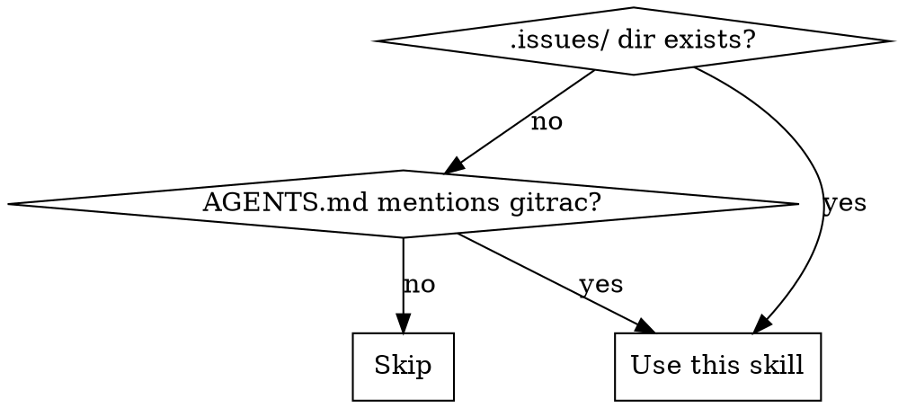

# Using gitrac

## Overview

gitrac manages project issues as markdown files in the git repo itself. Issues live in `.issues/`, closed issues in `.issues/closed/`. Every mutation auto-commits to git. Auto-commits include only the issue files gitrac touched; anything else you have staged stays staged and is not swept into the `issue:` commit.

Mutations are safe to run in parallel (multiple agents, worktrees, or the web UI at the same time): gitrac serializes them with a lock in the git dir, so IDs never collide and commits don't fail on git locks. New IDs also skip any ID used on another worktree or any branch you have locally (including fetched remote branches), and creating an issue doesn't touch `config.yaml`, so parallel branches merge cleanly. Only unfetched work from another clone can still reuse an ID — `git fetch` before creating issues if others are working in separate clones. If a gitrac process is killed, its stale lock is cleaned up automatically. Editing an issue from the CLI while it's open in the web UI is safe too: the browser picks up your change, and if someone has unsaved edits to that description they get a conflict notice instead of the autosave overwriting your text.

gitrac finds the project via `git rev-parse --show-toplevel`, so commands work from any subdirectory of the repo (or with `--dir <path>` pointing anywhere inside it). `.issues/` always lives at the repo root.

**Core principle:** Claim before working. Close in the same commit as the code change.

## When to Use



- Project has a `.issues/` directory at the repo root
- AGENTS.md or CLAUDE.md references gitrac
- You've been asked to work on a gitrac issue

## Installation

```bash
curl -fsSL https://get.gitrac.dev | bash     # binary to ~/.local/bin (GITRAC_NONINTERACTIVE=1 in CI)
npm install -g @gitrac/cli                   # or via npm
gitrac --version
```

**From source (if working in the gitrac repo itself):** use `./gitrac <command>` instead of `gitrac`.

## Quick Reference

| Command | Description |
|---------|------------|
| `gitrac ls` | List open issues |
| `gitrac show <id>` | View issue details |
| `gitrac create -t "title"` | Create an issue |
| `gitrac claim <id>` | Assign to yourself + set in_progress (fails if someone else has it) |
| `gitrac ready` | Issues you can start now: open, unassigned or yours, no open blockers; by priority, then ID (`-o json`; filters `--status`, `--priority`, `--label`, `--mine`, `--search`, `--sort`) |
| `gitrac next --claim` | Pick the top ready issue that isn't already in progress and claim it, atomically (exit 5 `no_ready_issues` if none). Without `--claim` it just shows it |
| `gitrac link <id> --blocked-by 3,4` | `<id>` can't start until #3 and #4 are closed (`--parent <n>` makes it a sub-issue of #n). Rejects self-links, missing issues and cycles (exit 2) |
| `gitrac unlink <id> --blocked-by 3` | Remove a blocker (`--parent` clears the parent) |
| `gitrac unclaim <id>` | Give an issue back (alias `release`); `--stale 2h` releases someone else's claim only if it has had no activity for 2h |
| `gitrac ls --stale 2h` | Claims (`in_progress`) with no activity for 2h, here or in another worktree/branch: dead or stuck agents (`staleClaim` in `-o json`). `ready`/`next [--claim]` take `--stale 2h` too, to offer and take over such claims |
| `gitrac claim <id> --renew` | Heartbeat: renew your own claim (newer `updated`) so it is not stale |
| `gitrac review <id>` | Hand a claimed issue off for review: sets `reviewStatus`, keeps you as assignee, so it stays claimed until closed or unclaimed (exit 2 if no `reviewStatus` is configured; exit 3 if not claimed or someone else's, `--force` overrides; `-c` comment) |
| `gitrac close <id>` | Close an issue (moves to closed/; status = config `closeStatus`, default `done`; `--cancelled` = `cancelStatus`, default `cancelled`; `-s <status>` any closed status). Closing an issue someone else holds (here, in another worktree or on another branch) is exit 3 (`already_claimed`); `--force` overrides. Your own claim needs nothing |
| `gitrac commit <id> -c "summary" -- -m "fix: ... (#<id>)"` | Close the issue and `git commit` it with your staged changes, in ONE commit (the recommended way to finish). Takes the `close` options (`-c`, `--cancelled`, `-s`, `-f`); everything after `--` goes to `git commit` (no `-m`: git opens the editor). Exit 2 if nothing besides the issue is staged (stage with `git add`, or pass `-- -a`) or the git args have pathspecs; exit 7 if git fails or makes no commit (the close is undone, the issue is as before) |
| `gitrac close <id> --no-commit` | Close without committing (the alternative for atomic commits: then `git add -A && git commit`) |
| `gitrac close <id> -c "text"` | Close with an inline comment |
| `gitrac delete <id> --yes` | Delete an issue (duplicates, test issues) and the assets only it uses, and drop it from other issues' `blockedBy`/`parent`, in one commit. Without `--yes` and no terminal it only prints what would be deleted and exits 2; `--dry-run` previews (exit 0) |
| `gitrac renumber <id> --file <path>` | Give one copy of a duplicated issue ID (`duplicate_issue`) a fresh ID: renames the file, updates its `id`, adds a `Renumbered from #<old>` comment, commits (`-o json`: `oldId`, `newId`, `from`, `to`, `references`). Without `--file` it lists the files (exit 3). Issues linking to / mentioning the old ID are listed, not changed; `--update-refs` repoints their `blockedBy`/`parent`. `--force` for a non-duplicated ID |
| `gitrac reopen <id>` | Reopen a closed issue (status = config `defaultStatus`; `-s todo` to pick). Exit 3 (`already_claimed`) if someone else holds it in a newer version elsewhere; `--force` overrides |
| `gitrac create -t "title" --description-file desc.md` | Create with a markdown description (`-` = stdin; or `-d "text"`) |
| `gitrac comment <id> "text"` | Add a comment (or `--body-file <path\|->`) |
| `gitrac edit <id> -s todo` | Update status. Changing the status or assignee of an issue someone else holds (here, in another worktree or on another branch) is exit 3 (`already_claimed`); `--force` overrides. Other fields (`-t`, `-p`, `-l`, `-d`) are always fine |
| `gitrac edit <id> -d "text"` | Replace the description (or `--description-file <path\|->`). Values equal to the current ones are a no-op (exit 0, no write/commit, note on stderr); no flags at all is exit 2 |
| `gitrac install-merge-driver` | Once per clone: issue-aware `git merge`/`rebase` for `.issues/` (`init` does it too); also commits `.issues/.gitignore` (ignores web UI `drafts/`) if missing |
| `gitrac ls -o json` | Machine-readable output |
| `gitrac ls --mine` | Issues assigned to you |
| `gitrac ls --elsewhere` | Also list issues that exist only in another worktree or on an unmerged branch |
| `gitrac ls --priority urgent,high --label bug` | Filters take comma-separated values (any of); `--status all` includes closed |
| `gitrac ls --search "login timeout"` | Title/description contains every word |
| `gitrac serve -p 4000` | Start the web UI (bare `gitrac` also serves, on :3000 or the next free port; `-p` fails if that port is busy). It opens a browser unless `-n` / `--no-open`, stdout is not a TTY, `CI` is set, or `GITRAC_NO_OPEN=1`. Binds 127.0.0.1; `--host 0.0.0.0` exposes it to the network (no auth). Web changes are attributed to your git `user.name` (or `--author`); the sidebar's "Acting as" picker can switch to a configured assignee |

## The Workflow

### 1. Find work

```bash
gitrac ls        # everything open
gitrac ready     # only what you can start now (unblocked, not someone else's — in any worktree/branch)
```

Review the open issues. Pick one that matches the task at hand. To just take the most important unblocked issue, `gitrac next --claim` picks and claims it in one step (under the repo lock, so parallel agents never get the same one) — then skip step 2.

**Dependencies.** `blockedBy` lists issues that must be closed first; `ready`/`next` skip an issue while any blocker is open. A blocker counts as resolved when it is `done` **or** `cancelled` (or deleted). `parent` is informational (sub-issues), it doesn't block. `gitrac show <id>` lists the parent, sub-issues, blockers and the issues it blocks; `show <id> -o json` adds them as `dependencies: { parent, children, blockedBy, blocks, blocked }`, each linked issue as `{ id, title, status, resolved }` (`resolved`: closed or deleted). A linked issue that exists only in another worktree or on another branch (e.g. a sub-issue another agent filed) is shown with its title, status and `foundElsewhere: { ref, worktree? }`, and as a blocker it blocks `ready`/`next` in any status, even closed there, until its branch is merged here. When you discover that an issue depends on another, record it: `gitrac link <id> --blocked-by <other>`.

### 2. Claim it

```bash
gitrac claim <id>
```

This sets `assignee` to your git user and `status` to `in_progress`, and commits the change. Claims are exclusive:

- If the issue is already `in_progress` and assigned to someone else, `claim` fails with **exit code 3** and changes nothing. Pick another issue (or use `--force` only if you really mean to take it over). This includes claims made in **another worktree** (even uncommitted, `--no-commit`) or committed on **another branch**, local or fetched: gitrac compares the issue's versions everywhere and the one with the latest `updated` wins. The error says where (`… claimed by bob (in_progress) in worktree /path (branch agent-1)`); with `-o json` it has `claimedElsewhere: { ref, worktree?, assignee, status, updated }` (`status`: `in_progress` or the review status).
- If the issue is closed, `claim` fails with **exit code 4**. Use `gitrac reopen <id>` first, or `claim --force` to reopen and claim in one step. `claim` also fails with exit 4 when the issue is open here but was closed in **another worktree** or on **another branch** (e.g. an agent finished it and the branch isn't merged yet): the error says where (`Issue #1 is closed (done) in worktree /path (branch agent-1).`) and `-o json` has `closedElsewhere: { ref, worktree?, status, updated }`. Don't reopen it here; merge that branch to bring the close in. Use `--force` only if you really mean to claim it again (your newer claim would undo that close when the branch is merged).
- Claiming an issue you already own is a no-op (exit 0, no commit). If you already hold it in **another worktree** (or on another branch), `claim` succeeds but warns on stderr (`Warning: you already hold issue #N in worktree /path …; claimed it here too.`) — you probably meant to work on it there.

If you stop working on an issue without finishing it, give it back with `gitrac unclaim <id>` (alias `release`): it clears the assignee and moves `in_progress` (or the review status) back to `todo`. Releasing someone else's claim requires `--force` (exit 3 otherwise). This works across worktrees and branches too: `unclaim` from `main` releases a claim made in an agent's worktree (or committed on its branch) by writing a newer local version that supersedes it, so the issue is ready again for everyone. The release is always newer, also when the claim was made in the same millisecond or on a machine whose clock is ahead (gitrac sets `updated` 1 ms after the newest version it found if necessary). `claim --force` works the same way. The error (and its `-o json` `claimedElsewhere`) says where someone else's claim is.

Humans can claim and release issues from the web UI too: the "Claim" / "Release" buttons in the issue sidebar act as the "Acting as" user and use the same rules (`POST /api/issues/:id/claim` / `unclaim`), so their claims block your `claim` (exit 3) like any other, and they can't silently take over yours without choosing "Take over".

`edit` can't silently overwrite a claim either: `gitrac edit <id> -s ...` or `-a ...` on an issue held by someone else (judged across worktrees and branches, like `claim`) fails with exit 3 (`already_claimed`, with `claimedElsewhere` in `-o json`) and changes nothing. Use `claim --force` to take it over, or `edit --force` to change the field anyway. The web UI's status and assignee dropdowns follow the same rule (they offer "Change anyway"). The holder can always edit, and other fields (title, priority, labels, description) need no claim. `close` and `reopen` follow the same rule: closing (or reopening) an issue someone else holds fails with exit 3 and changes nothing, so a close on `main` can't silently supersede a newer claim in an agent's worktree. `close --force` / `reopen --force` do it anyway (the newer version supersedes the claim). Closing your own claim, or an unclaimed issue, needs no flag.

`ls`, `show` and `ready` flag issues claimed elsewhere: `[claimed on branch X by Y]` in the list, an `Elsewhere:` line in `show`, and a `claimedElsewhere` field in `-o json` (the web UI shows a `claimed by Y in …` badge, and `GET /api/issues[/:id]` has the same `claimedElsewhere` field, refreshed within a few seconds). They also flag issues that are open here but closed elsewhere (finished work waiting for a merge): `[closed (done) on branch X]` / `[closed (done) in worktree P (branch X)]`, an `Elsewhere:` line, and a `closedElsewhere` field (a `Done in …` badge in the web UI). `ready`/`next` skip issues claimed (or closed) in another worktree or on an unmerged branch. A later unclaim or close anywhere supersedes the claim. A claim stuck on an abandoned branch stays visible until you delete that branch (`git branch -D <branch>`, or `git fetch --prune` for remote ones) or take it over with `claim --force`.

### 3. Implement the fix/feature

Write code, run tests — the normal development workflow. The issue file in `.issues/` serves as your spec.

### 4. Document what was done

**Always add a comment before closing.** The comment should read like a PR description. You can either use the standalone comment command or the `--comment` / `-c` flag on close:

```bash
# Standalone comment
gitrac comment <id> "Summary of changes: what was fixed/added, why, files affected, and any notable decisions."

# Or inline when you close (preferred)
gitrac commit <id> --comment "Summary of changes" -- -m "fix: ... (#<id>)"
```

The comment becomes part of the issue's permanent history. Write it for someone who needs to understand what happened without reading every diff line.

The `--comment` / `-c` flag is also available on `claim`, `unclaim`, `edit`, and `reopen`.

### 5. Close with the code change

This is the key pattern. Close the issue **in the same commit** as the code change:

```bash
# Stage the code changes
git add -A

# Close the issue (with a comment) and git commit it with the staged changes
gitrac commit <id> -c "Summary of what was done" -- -m "fix: resolve the problem (#<id>)"
```

This creates a single commit that contains both the code fix and the issue state change. Anyone looking at the commit sees exactly what was fixed and why.

- Everything after `--` goes to `git commit` unchanged. gitrac adds no commit message: use `-m`, `-F`, or leave them out to get the editor. Reference the issue in the message (`(#<id>)`).
- Stage your changes first, or pass `-- -a` to commit all changes to tracked files. If nothing besides the issue is staged, it exits 2 and changes nothing (use `gitrac close <id>` to commit only the issue). `--amend` needs no staged changes.
- Pathspecs (`-- -m msg src/file.ts`) are rejected (exit 2): git would commit only those paths and leave the issue file out. Stage the files with `git add` instead.
- If `git commit` fails or makes no commit (a hook rejects it, `--dry-run`, an empty message), it exits 7 (`git_error`, `exitCode` = git's status) and the issue files and index are put back as they were (the issue is still open, your claim is unchanged). Fix the problem and run it again.
- The close rules are those of `close`: someone else's claim needs `-f` (exit 3 without it). `--no-commit` cannot be used with it (exit 2). With `-o json`, git's output goes to stderr and stdout is one `{ issue, commit }` object.
- It pushes afterwards per `--push` / `git.autoPush`, like other commands.

The alternative is to close without committing and commit yourself:

```bash
gitrac close <id> --no-commit -c "Summary of what was done"
git add -A                   # code changes + the closed issue file
git commit -m "fix: resolve the problem (#<id>)"
```

### 6. Verify

```bash
gitrac ls              # issue should no longer appear
gitrac show <id>       # should show status: done, in .issues/closed/
```

## Parallel Agents in Worktrees

Recommended workflow when an orchestrator runs several agents at once:

1. The orchestrator creates one worktree (and branch) per agent: `git worktree add -b agent-1 ../agent-1`.
2. Each agent runs gitrac **inside its own worktree** and claims there: `gitrac claim <id>` (or `gitrac next --claim`). The claim is visible to every other worktree immediately — committed or not — so other agents' `claim` fails with exit 3 and their `ready`/`next` skip it. Agents sharing one git identity still get different issues from `next --claim`.
3. When done, the agent stages its changes and runs `gitrac commit <id> -c "summary" -- -m "fix: ... (#<id>)"`, which commits the code and the issue file together on its branch (or `gitrac close <id> --no-commit -c "summary"` and then `git commit`). Until that branch is merged, the issue no longer shows up in `ready`/`next` elsewhere.
   **Review handoff** (if the project sets `reviewStatus` in `config.yaml`): instead of closing, the agent runs `gitrac review <id> --no-commit -c "summary"` and commits on its branch. The issue keeps its assignee and stays claimed: other agents' `claim` fails with exit 3, `next` skips it, `ls` shows `[claimed … by <agent>]`. The orchestrator verifies, merges and closes it. The issue is still the agent's claim, so if the orchestrator has a different identity it closes with `gitrac close <id> --force` (exit 3 without it). To send it back, the agent runs `gitrac claim <id>` again (it returns to `in_progress`).
4. If an agent gives up or dies, release its claim from anywhere (e.g. the main worktree): `gitrac unclaim <id>` (add `--force` if the agent used a different identity). The newer release supersedes the claim in its worktree, so `ready`/`next` offer the issue again. To close a stuck agent's issue instead (e.g. the work is done or no longer needed), use `gitrac close <id> --force` (exit 3 without it, since the agent still holds it); the forced close supersedes the claim in its worktree. An agent closing its own claim (step 3) needs no `--force`.
   **Dead-agent recovery:** a claim is *stale* when the issue's newest version (here, in any worktree or on any branch) is in `in_progress`, assigned, and its `updated` is older than a duration (`30s`, `45m`, `2h`, `1d`). Every gitrac write to the issue bumps `updated`, so any activity counts. `gitrac ls --stale 2h` lists the stale claims (`[stale claim by X, last activity <iso>]`; `staleClaim: { assignee, updated, ref?, worktree? }` in `-o json`). `gitrac unclaim <id> --stale 2h` releases one without `--force` (exit 3 if it is not stale, with its age). `gitrac next --claim --stale 2h` can pick one and take it over: under the repo lock it checks again that the claim is still stale, so it never steals a claim that was just renewed. A claim in the review status is never stale. Without `--stale`, nothing changes. The optional `staleAfter: 2h` key in `config.yaml` is only the web UI's threshold (stale badges, "Release stale claim", `staleClaim` in API responses); CLI commands ignore it, so always pass `--stale` explicitly.
   **Heartbeats:** a long-running agent should renew its claim from time to time with `gitrac --no-commit claim <id> --renew` (in its worktree; other worktrees read its working file, so no commit is needed). On a claim you don't hold, `--renew` is a normal claim.
5. Agents can file new issues (bugs found, sub-tasks) with `gitrac create` in their worktree. Before the branch is merged, the orchestrator sees them from `main` with `gitrac ls --elsewhere` (marked `[only in worktree P (branch X)]` / `[only on branch X]`; `foundElsewhere` in `-o json`) and `gitrac show <id>` (a stderr note says where the version comes from). They are read-only there: `claim`, `edit`, `close` etc. need the file, so merge the branch first (exit 5 until then).
6. The orchestrator merges the branches; the gitrac merge driver (below) merges the `.issues/` files. Delete merged/abandoned agent branches so stale claims don't linger.

## Merging Branches

With the gitrac merge driver installed (`gitrac init` installs it; in an existing clone run `gitrac install-merge-driver` once — the git config part isn't versioned), git merges issue files field by field instead of line by line: comments from both branches are kept, a field changed on one side wins, a field changed on both goes to the side updated last, labels and `blockedBy` merge as sets, and `config.yaml` labels/assignees are unioned. A rename (title change) or close on one branch plus edits on the other merges into the renamed file. Only these need you:

- **Both branches edited the same lines of a description:** the merge stops with conflict markers inside the description (frontmatter and comments are already merged). Edit them out, `git add`, continue.
- **Both branches changed the title:** git reports a rename/rename conflict and leaves two files with the same merged content. Keep the one matching the title, `git rm` the other.
- **A file the driver can't parse** (hand-broken YAML, leftover markers): you get git's normal conflict markers for the whole file.
- **Closed on one branch, edited later on the other:** the merged status can be open while the file is in `closed/` (or the inverse). Nothing is lost: `ls` and the web UI list it by its status, and `ls` warns `issue file <path> is in the wrong directory for its status` on stderr. The next edit, comment, link, close or reopen of the issue moves the file.
- **Same ID created in two clones** (`12-a.md` and `12-b.md`): not a merge conflict; gitrac then fails with `duplicate_issue` (exit 3). Run `gitrac renumber 12 --file .issues/12-b.md` to give one copy a new ID, then check the issues it lists as referencing #12 (the old links/mentions could mean either issue; `--update-refs` points their `blockedBy`/`parent` at the new ID).

## Reading Issues Directly

Issues are plain markdown. You can read them without the CLI:

```
.issues/<id>-<slug>.md     # open issues
.issues/closed/<id>-<slug>.md  # closed issues
```

Format: YAML frontmatter (id, title, status, priority, assignee, labels, optional `parent` / `blockedBy`, dates; any other keys you add, like `estimate:`, are kept verbatim after these and shown read-only as `extra` in `-o json`) followed by a markdown description, then optionally a `---` separator and comments. Each comment starts with `### author — timestamp`. Only a `---` immediately followed (after blank lines) by a comment header is the separator; other horizontal rules in the description are preserved.

When reading comment bodies, headings are escaped (`\## Heading` means `## Heading`). A comment-header-like line right after a `---` in a description is likewise escaped (`\### a — b`).

## Structured Output for Agents

Use `-o json` or `-o yaml` for machine-readable output:

```bash
gitrac ls -o json                    # all open issues as JSON array
gitrac show <id> -o json             # single issue as JSON, plus resolved `dependencies`
gitrac ls -o json --status all       # include closed issues
gitrac ls -o json --mine --status todo,in_progress  # my active work
gitrac ready -o json                 # what can be started now
gitrac next --claim -o json          # claim the top ready issue (exit 5 if none)
```

This is useful for programmatic decision-making about which issue to work on.

### Errors and exit codes

stdout only ever holds the result. Errors and warnings (e.g. "not on the default branch") go to **stderr**. With `-o json`, the error is a single JSON line — the last line of stderr:

```json
{"error":{"code":"not_found","message":"Issue #9 not found","id":9}}
```

(`-o yaml` prints the same object as YAML; human mode prints `Error: <message>`.) Branch on the exit code or `code`:

| Exit | `code` | Meaning |
|------|--------|---------|
| 0 | | Success |
| 1 | `error`, `invalid_config`, `invalid_issue` | Unexpected error, unparseable `.issues/config.yaml`, or a malformed issue file (no frontmatter, bad YAML, `id` not matching the file name; `file` names it, nothing is written — fix the file by hand) |
| 2 | `invalid_input`, `usage`, `confirmation_required` | Bad ID / field value / flag / missing argument, `commit` with nothing staged besides the issue or with git pathspecs, or `delete` without `--yes` (stdin not a terminal). Nothing was written |
| 3 | `already_claimed`, `already_initialized`, `invalid_state`, `duplicate_issue` | Conflict: claimed by someone else (`claim`, `unclaim`, `review`, `close`, `reopen`, or `edit` of the status / assignee), already initialized, closing a closed / reopening an open issue, or several files on disk for one issue ID (`files` lists them: merge them by hand and delete all but one, or `gitrac renumber <id> --file <path>` if they are different issues); `renumber` of a non-duplicated ID without `--force` |
| 4 | `issue_closed` | `claim`/`unclaim`/`review` on a closed issue |
| 5 | `not_found`, `no_ready_issues` | No such issue; `next` found no ready issue |
| 6 | `lock_timeout` | Another gitrac process held the repo lock too long — retry |
| 7 | `git_error` | git commit/push failed (the issue file may already be changed: check `git status`). For `gitrac commit`, a failed `git commit` undoes the close |
| 8 | `not_a_git_repo`, `not_initialized` | Not in a git repo, or run `gitrac init` |

Stack traces are hidden unless you pass `--debug`.

## Common Mistakes

| Mistake | Why it's wrong | Fix |
|---------|---------------|-----|
| Closing in a separate commit | Breaks the atomic link between fix and issue | `git add` the code, then `gitrac commit <id> -c "..." -- -m "..."` |
| Not claiming before working | Another agent may start the same work | Always `claim` first |
| `edit -s`/`-a` instead of `claim` / `unclaim` | Skips the claim checks; on someone else's claim it fails (exit 3) | Use `claim` / `unclaim`; `edit --force` only if you mean to overwrite their claim |
| Editing issue files directly | Bypasses git auto-commit, may produce invalid format | Use the CLI |
| `gitrac close` without `--no-commit` before your own commit | Creates two commits instead of one | Use `gitrac commit <id>`, or close with `--no-commit`, then `git add -A && git commit` |
| `gitrac commit <id> -- -m msg some/file` | Pathspecs would leave the issue out of the commit, so it is rejected (exit 2) | `git add some/file`, then `gitrac commit <id> -- -m msg` |
| Working on closed issues | They live in `closed/` and are done | Check `gitrac show <id>` first |
| Closing without a comment | Loses context about what was done and why | Always `gitrac comment <id> "..."` before closing |
| Deleting an issue you just don't want to do | Erases its history from the tracker | `gitrac close <id> --cancelled -c "why"`; reserve `delete` for duplicates / test issues |

## Creating Issues

When you discover a bug or identify needed work during development:

```bash
gitrac create -t "Brief description" -p high -l bug
```

Flags: `-t` title (required — without it, and no terminal, `create` exits 2 rather than prompting), `-p` priority, `-l` labels (comma-separated), `-a` assignee, `-s` status, `-d` description (markdown), `--description-file <path|->` description from a file or stdin (`-`).

Status and priority must be one of the values in `.issues/config.yaml` — anything else is rejected (exit 2, nothing written). Titles, assignees and labels must be one line, and an author name (`--author`, or your git `user.name` when it writes a comment or `createdBy`) must have no line break and no em dash (U+2014); otherwise exit 2, nothing written. `gitrac serve --author <name>` checks the name at startup (exit 2). New labels are added to the config automatically with a color.

**Statuses and priorities are project-specific.** Check `statuses` / `priorities` in `.issues/config.yaml` (or the error message, which lists them) rather than assuming the defaults (`backlog, todo, in_progress, done, cancelled`; `urgent, high, medium, low, none`). A status entry is a plain name or `{ name, label?, color?, closed? }`; `closed: true` statuses live in `.issues/closed/` (also when an issue is created with one; plain `done`/`cancelled` are closed, other plain names open). Optional keys pick the statuses commands use: `activeStatus` (what `claim` sets; default `in_progress`), `unclaimStatus` (`todo`), `reviewStatus` (what `review` sets; unset = no review step; an assigned issue in it is still claimed), `closeStatus` (`done`), `cancelStatus` (`cancelled`; without one, `close --cancelled` exits 2). In this guide `in_progress` / `todo` / `done` mean those configured statuses. An inconsistent config (e.g. `defaultStatus` closed, no closed status) makes every command exit 1 (`invalid_config`) listing each problem.

Don't over-describe in the title — put details (context, acceptance criteria) in the markdown description. For multi-line text, use a heredoc instead of shell-quoting:

```bash
gitrac create -t "Fix login timeout" -p high -l bug --description-file - <<'EOF'
Sessions expire after 5 minutes instead of 30.

## Acceptance criteria
- Session lifetime honors `SESSION_TTL`
EOF
```

`gitrac edit <id> -d "..."` / `--description-file` replaces the description later; `gitrac comment <id> --body-file -` does the same for long comments. Passing both the inline and file form is an error.
