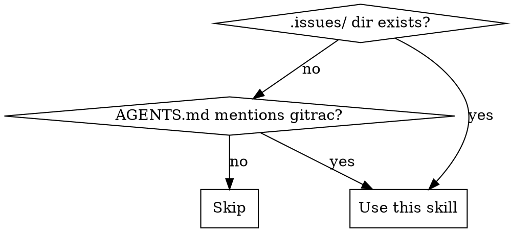

# Using gitrac

## Overview

gitrac manages project issues as markdown files in the git repo itself. Issues live in `.issues/`, closed issues in `.issues/closed/`. Every mutation auto-commits to git. Auto-commits include only the issue files gitrac touched; anything else you have staged stays staged and is not swept into the `issue:` commit.

Mutations are safe to run in parallel (multiple agents, worktrees, or the web UI at the same time): gitrac serializes them with a lock in the git dir, so IDs never collide and commits don't fail on git locks. New IDs also skip any ID used on another worktree or any branch you have locally (including fetched remote branches), and creating an issue doesn't touch `config.yaml`, so parallel branches merge cleanly. Only unfetched work from another clone can still reuse an ID — `git fetch` before creating issues if others are working in separate clones. If a gitrac process is killed, its stale lock is cleaned up automatically. Editing an issue from the CLI while it's open in the web UI is safe too: the browser picks up your change, and if someone has unsaved edits to that description they get a conflict notice instead of the autosave overwriting your text.

gitrac finds the project via `git rev-parse --show-toplevel`, so commands work from any subdirectory of the repo (or with `--dir <path>` pointing anywhere inside it). `.issues/` always lives at the repo root.

**Core principle:** Claim before working. Close in the same commit as the code change.

## When to Use



- Project has a `.issues/` directory at the repo root
- AGENTS.md or CLAUDE.md references gitrac
- You've been asked to work on a gitrac issue

## Installation

**From GitHub releases (standalone binary):**
```bash
# Download for your platform from https://github.com/murrayju/gitrac/releases
# Place the binary on your PATH
gitrac --help
```

**From source (if working in the gitrac repo itself):**
```bash
./bun index.ts <command>
```

When installed as a binary, replace `./bun index.ts` with `gitrac` in all examples below.

## Quick Reference

| Command | Description |
|---------|------------|
| `gitrac ls` | List open issues |
| `gitrac show <id>` | View issue details |
| `gitrac create -t "title"` | Create an issue |
| `gitrac claim <id>` | Assign to yourself + set in_progress (fails if someone else has it) |
| `gitrac unclaim <id>` | Give an issue back (alias `release`) |
| `gitrac close <id>` | Close an issue (moves to closed/) |
| `gitrac close <id> --no-commit` | Close without committing (for atomic commits) |
| `gitrac close <id> -c "text"` | Close with an inline comment |
| `gitrac reopen <id>` | Reopen a closed issue (status = config `defaultStatus`; `-s todo` to pick) |
| `gitrac create -t "title" --description-file desc.md` | Create with a markdown description (`-` = stdin; or `-d "text"`) |
| `gitrac comment <id> "text"` | Add a comment (or `--body-file <path\|->`) |
| `gitrac edit <id> -s todo` | Update status |
| `gitrac edit <id> -d "text"` | Replace the description (or `--description-file <path\|->`) |
| `gitrac ls -o json` | Machine-readable output |
| `gitrac serve -p 4000` | Start the web UI (bare `gitrac` also serves, on :3000). Binds 127.0.0.1; `--host 0.0.0.0` exposes it to the network (no auth). Web changes are attributed to your git `user.name` (or `--author`); the sidebar's "Acting as" picker can switch to a configured assignee |

## The Workflow

### 1. Find work

```bash
gitrac ls
```

Review the open issues. Pick one that matches the task at hand.

### 2. Claim it

```bash
gitrac claim <id>
```

This sets `assignee` to your git user and `status` to `in_progress`, and commits the change. Claims are exclusive:

- If the issue is already `in_progress` and assigned to someone else, `claim` fails with **exit code 3** and changes nothing. Pick another issue (or use `--force` only if you really mean to take it over).
- If the issue is closed, `claim` fails with **exit code 4**. Use `gitrac reopen <id>` first, or `claim --force` to reopen and claim in one step.
- Claiming an issue you already own is a no-op (exit 0, no commit).

If you stop working on an issue without finishing it, give it back with `gitrac unclaim <id>` (alias `release`): it clears the assignee and moves `in_progress` back to `todo`. Releasing someone else's claim requires `--force`.

### 3. Implement the fix/feature

Write code, run tests — the normal development workflow. The issue file in `.issues/` serves as your spec.

### 4. Document what was done

**Always add a comment before closing.** The comment should read like a PR description. You can either use the standalone comment command or the `--comment` / `-c` flag on close:

```bash
# Standalone comment
gitrac comment <id> "Summary of changes: what was fixed/added, why, files affected, and any notable decisions."

# Or inline with close (preferred for atomic workflows)
gitrac close <id> --no-commit --comment "Summary of changes"
```

The comment becomes part of the issue's permanent history. Write it for someone who needs to understand what happened without reading every diff line.

The `--comment` / `-c` flag is also available on `claim`, `unclaim`, `edit`, and `reopen`.

### 5. Close with the code change

This is the key pattern. Close the issue **in the same commit** as the code change:

```bash
# Close the issue with a comment, without auto-committing
gitrac close <id> --no-commit -c "Summary of what was done"

# Stage everything together: code changes + the closed issue file
git add -A

# One atomic commit
git commit -m "fix: resolve the problem (#<id>)"
```

This creates a single commit that contains both the code fix and the issue state change. Anyone looking at the commit sees exactly what was fixed and why.

### 6. Verify

```bash
gitrac ls              # issue should no longer appear
gitrac show <id>       # should show status: done, in .issues/closed/
```

## Reading Issues Directly

Issues are plain markdown. You can read them without the CLI:

```
.issues/<id>-<slug>.md     # open issues
.issues/closed/<id>-<slug>.md  # closed issues
```

Format: YAML frontmatter (id, title, status, priority, assignee, labels, dates) followed by a markdown description, then optionally a `---` separator and comments. Each comment starts with `### author — timestamp`. Only a `---` immediately followed (after blank lines) by a comment header is the separator; other horizontal rules in the description are preserved.

When reading comment bodies, headings are escaped (`\## Heading` means `## Heading`). A comment-header-like line right after a `---` in a description is likewise escaped (`\### a — b`).

## Structured Output for Agents

Use `-o json` or `-o yaml` for machine-readable output:

```bash
gitrac ls -o json                    # all open issues as JSON array
gitrac show <id> -o json             # single issue as JSON
gitrac ls -o json --status all       # include closed issues
```

This is useful for programmatic decision-making about which issue to work on.

### Errors and exit codes

stdout only ever holds the result. Errors and warnings (e.g. "not on the default branch") go to **stderr**. With `-o json`, the error is a single JSON line — the last line of stderr:

```json
{"error":{"code":"not_found","message":"Issue #9 not found","id":9}}
```

(`-o yaml` prints the same object as YAML; human mode prints `Error: <message>`.) Branch on the exit code or `code`:

| Exit | `code` | Meaning |
|------|--------|---------|
| 0 | | Success |
| 1 | `error`, `invalid_config` | Unexpected error, or unparseable `.issues/config.yaml` |
| 2 | `invalid_input`, `usage` | Bad ID / field value / flag / missing argument — nothing was written |
| 3 | `already_claimed`, `already_initialized`, `invalid_state`, `duplicate_issue` | Conflict: claimed by someone else, already initialized, closing a closed / reopening an open issue, or several files on disk for one issue ID (`files` lists them — merge them by hand and delete all but one) |
| 4 | `issue_closed` | `claim`/`unclaim` on a closed issue |
| 5 | `not_found` | No such issue |
| 6 | `lock_timeout` | Another gitrac process held the repo lock too long — retry |
| 7 | `git_error` | git commit/push failed (the issue file may already be changed — check `git status`) |
| 8 | `not_a_git_repo`, `not_initialized` | Not in a git repo, or run `gitrac init` |

Stack traces are hidden unless you pass `--debug`.

## Common Mistakes

| Mistake | Why it's wrong | Fix |
|---------|---------------|-----|
| Closing in a separate commit | Breaks the atomic link between fix and issue | Use `--no-commit` on close, commit together |
| Not claiming before working | Another agent may start the same work | Always `claim` first |
| Editing issue files directly | Bypasses git auto-commit, may produce invalid format | Use the CLI |
| Forgetting `--no-commit` on close | Creates two commits instead of one | Close with `--no-commit`, then `git add -A && git commit` |
| Working on closed issues | They live in `closed/` and are done | Check `gitrac show <id>` first |
| Closing without a comment | Loses context about what was done and why | Always `gitrac comment <id> "..."` before closing |

## Creating Issues

When you discover a bug or identify needed work during development:

```bash
gitrac create -t "Brief description" -p high -l bug
```

Flags: `-t` title (required), `-p` priority, `-l` labels (comma-separated), `-a` assignee, `-s` status, `-d` description (markdown), `--description-file <path|->` description from a file or stdin (`-`).

Status and priority must be one of the values in `.issues/config.yaml` — anything else is rejected (exit 2, nothing written). New labels are added to the config automatically with a color.

Don't over-describe in the title — put details (context, acceptance criteria) in the markdown description. For multi-line text, use a heredoc instead of shell-quoting:

```bash
gitrac create -t "Fix login timeout" -p high -l bug --description-file - <<'EOF'
Sessions expire after 5 minutes instead of 30.

## Acceptance criteria
- Session lifetime honors `SESSION_TTL`
EOF
```

`gitrac edit <id> -d "..."` / `--description-file` replaces the description later; `gitrac comment <id> --body-file -` does the same for long comments. Passing both the inline and file form is an error.
